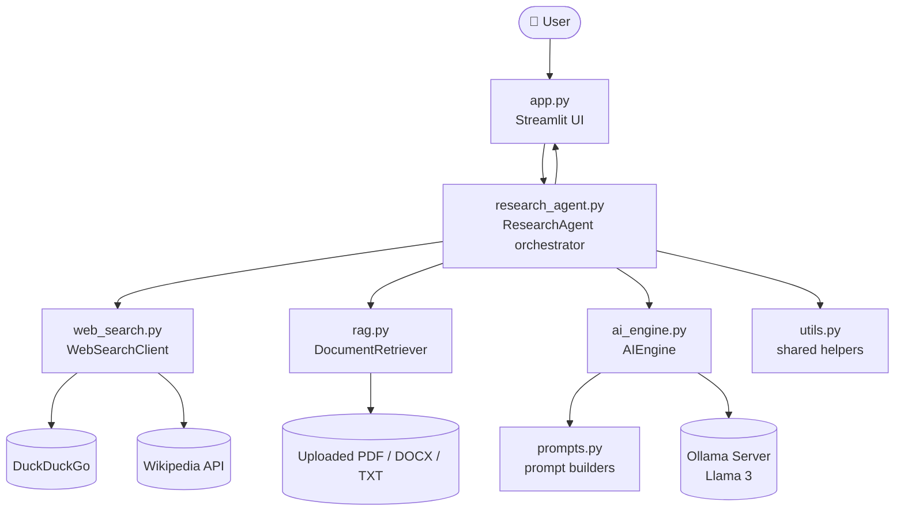
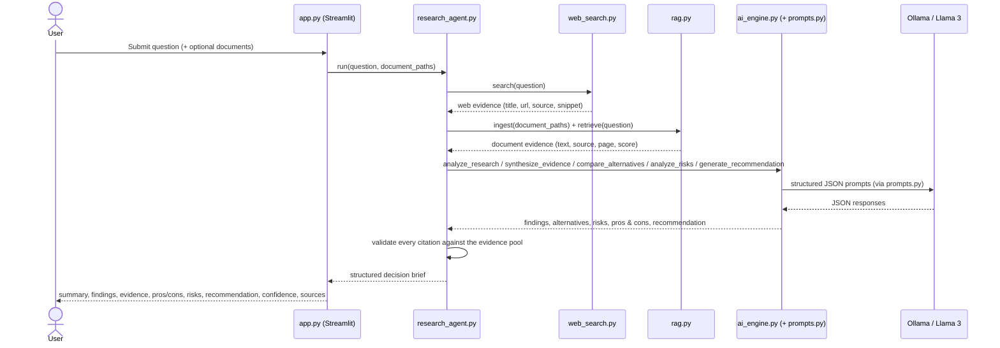

# 🧭 Enterprise AI Research & Decision Intelligence Agent

*A locally-hosted, LLM-powered decision-support platform that turns open business questions into structured, evidence-backed, citation-verified decision briefs — not chat answers.*

---

## Table of Contents

- [Project Overview](#project-overview)
- [Problem Being Solved](#problem-being-solved)
- [Key Features](#key-features)
- [Architecture](#architecture)
- [End-to-End Workflow](#end-to-end-workflow)
- [Technology Stack](#technology-stack)
- [Folder Structure](#folder-structure)
- [Installation Instructions](#installation-instructions)
- [Virtual Environment Setup](#virtual-environment-setup)
- [Ollama Installation](#ollama-installation)
- [Llama 3 Setup](#llama-3-setup)
- [Dependency Installation](#dependency-installation)
- [Running the Streamlit Application](#running-the-streamlit-application)
- [Example Research Questions](#example-research-questions)
- [Example Decision Report](#example-decision-report)
- [RAG Workflow](#rag-workflow)
- [Web Research Workflow](#web-research-workflow)
- [Future Improvements](#future-improvements)
- [Limitations](#limitations)

---

## Project Overview

The **Enterprise AI Research & Decision Intelligence Agent** is a decision-support platform for business, product, and strategy teams. Instead of returning a single freeform paragraph like a general-purpose chatbot, it runs a **multi-stage reasoning pipeline** over live web research and internal documents, and returns a fixed-schema **decision brief**: executive summary, key findings, evidence, pros and cons, categorized risks, a recommendation, a confidence score, and a verifiable source list.

It is designed around three enterprise-grade principles:

1. **Grounded, not generative-only.** Every conclusion is expected to trace back to retrieved evidence. Citations are cross-checked against the actual evidence pool before being shown, so the model cannot silently invent a source.
2. **Private by design.** Reasoning runs on a **self-hosted Llama 3 model via Ollama** — uploaded documents and their analysis never leave your infrastructure. Only web-search queries reach the public internet.
3. **Modular and auditable.** Search, retrieval, prompting, and orchestration are separated into independent modules with narrow responsibilities, so any layer (the search provider, the vector store, the LLM backend) can be inspected, tested, or replaced on its own.

This project is intentionally scoped as a **decision-support tool**, not an autonomous decision-maker — see [Limitations](#limitations).

## Problem Being Solved

Enterprise decisions — market entry, vendor selection, build-vs-buy, technology migration — typically require an analyst to manually search the web, read internal reports and PDFs, weigh competing options, and write up a memo with sources. This process is:

- **Slow and inconsistent** — every analyst structures their findings differently.
- **Hard to audit** — conclusions are often disconnected from the specific evidence that produced them.
- **Poorly suited to plain chatbots** — a generic LLM chat interface can summarize text, but it doesn't systematically gather evidence, compare alternatives on the same criteria, separate fact from inference, or guarantee its citations are real.

This agent automates the research-and-synthesis loop while keeping every step traceable: it gathers evidence from the web and from uploaded documents, runs that evidence through a structured, multi-stage analysis, and returns the same decision-brief schema every time — so results are consistent, comparable across questions, and defensible to a reviewer.

## Key Features

- **Structured decision briefs, not chat replies.** Every run returns the same fixed shape (summary, findings, evidence, pros/cons, risks, recommendation, confidence, sources), suitable for review or export rather than freeform prose.
- **Multi-source evidence gathering.** Combines live web search (DuckDuckGo + Wikipedia, deduplicated and ranked with an authority boost for domains like `.gov`, `.edu`, and major standards bodies) with retrieval over uploaded PDF/DOCX/TXT documents.
- **Anti-hallucination citation guard.** Every citation the model produces is cross-checked against the real, retrieved evidence pool. Citations that reference evidence that doesn't exist are dropped rather than trusted.
- **Multi-stage reasoning pipeline.** Rather than one opaque prompt, the workflow runs discrete stages — question framing, evidence synthesis, alternative/multi-source comparison, risk analysis, pros and cons, recommendation, final report — each independently promptable, testable, and auditable.
- **Evidence-aware confidence scoring.** Confidence blends the model's own self-assessment with how much evidence was actually found, so a thin evidence base can't produce an artificially high score.
- **Graceful degradation everywhere.** A failed web search, an unreadable or corrupted upload, or a malformed model response is logged and skipped — it never crashes the run. The final report notes what could and couldn't be established.
- **Lightweight, dependency-minimal RAG.** Document retrieval runs on a hand-rolled TF-IDF vector representation, entirely in memory — no external vector database, no downloaded embedding model, no extra infrastructure to operate.
- **Swappable, single-responsibility modules.** The web search providers, the vector store, and the LLM backend each sit behind a small interface, so any one of them can be upgraded or replaced without touching the rest of the system.

## Architecture



### Module Responsibilities

| Module | Responsibility |
|---|---|
| `app.py` | Streamlit UI only: question input, file upload, progress indicators, results rendering. No AI, RAG, or search logic. |
| `research_agent.py` | Orchestrates the full workflow — merges web and document evidence, drives the AI reasoning stages, validates citations, blends the confidence score. |
| `ai_engine.py` | Sole point of contact with Ollama/Llama 3. Sends structured prompts, requests JSON output, defensively parses and retries on malformed responses. |
| `web_search.py` | Multi-provider web research (DuckDuckGo, Wikipedia), URL-based deduplication, authority-aware ranking. |
| `rag.py` | Extracts text from PDF/DOCX/TXT, splits it into meaningful chunks, and indexes/retrieves it via an in-memory vector store. |
| `prompts.py` | One reusable, evidence-grounded prompt template per reasoning stage, sharing a common set of anti-hallucination and JSON-output rules. |
| `utils.py` | Small, dependency-free helpers used across the project: text cleaning, validation, safe JSON parsing, deduplication, formatting. |

Each module is deliberately narrow: `app.py` never touches the model or the web, `web_search.py` and `rag.py` never call the LLM, and `ai_engine.py` never implements search, parsing, or UI. `research_agent.py` is the only module that depends on all of the others.

## End-to-End Workflow



In short:

1. The user submits a research question or business decision problem, optionally with supporting PDF/DOCX/TXT documents.
2. `web_search.py` gathers external evidence from multiple providers and returns it deduplicated and ranked.
3. `rag.py` extracts, chunks, and retrieves the most relevant passages from any uploaded documents.
4. Web and document evidence are merged into one source-tagged evidence pool, each item carrying a stable evidence id.
5. `ai_engine.py`, driven by prompts from `prompts.py`, reasons over that evidence in discrete stages to produce findings, an alternatives comparison, risks, pros/cons, and a recommendation.
6. `research_agent.py` validates every citation the model produced against the real evidence pool, discarding anything unverifiable.
7. A confidence score is computed from the model's own estimate and how much evidence actually supported it.
8. The final structured result is returned to `app.py` and rendered as a decision brief.

## Technology Stack

| Layer | Technology | Purpose |
|---|---|---|
| UI | [Streamlit](https://streamlit.io/) | Single-page interface for input, upload, progress, and results |
| LLM runtime | [Ollama](https://ollama.com/) running **Llama 3** | Local, private model inference — model and host are configurable |
| Orchestration | Plain Python (dataclasses, no agent framework) | Deterministic, inspectable workflow control in `research_agent.py` |
| Web search | `duckduckgo-search` + Wikipedia MediaWiki API (`requests`) | Multi-source, no-API-key external research |
| Document parsing | `pypdf`, `python-docx`, built-in file I/O | PDF, DOCX, and TXT text extraction |
| Retrieval (RAG) | Hand-rolled TF-IDF vectorizer + cosine similarity, in-memory | Lightweight, dependency-free document retrieval — no external vector database |
| Language | Python 3.10+ | Implementation language throughout |

## Folder Structure

```
enterprise-ai-research-agent/
│
├── app.py              # Streamlit UI — input, upload, progress, results display only
├── research_agent.py   # Workflow orchestration: combines web search + RAG + AI reasoning
├── ai_engine.py         # All Ollama/Llama 3 communication + structured JSON generation
├── web_search.py        # Multi-provider web research (DuckDuckGo, Wikipedia), dedup + ranking
├── rag.py                # PDF/DOCX/TXT extraction, chunking, lightweight in-memory vector store
├── prompts.py            # Reusable, evidence-grounded prompt templates for every AI stage
├── utils.py              # Shared helpers: text cleaning, validation, JSON parsing, formatting
├── requirements.txt      # Python dependencies
└── README.md             # This file
```

## Installation Instructions

**Prerequisites:**

- Python 3.10 or later
- `pip` and `git`
- ~8 GB of free disk space and memory headroom for running Llama 3 locally
- [Ollama](https://ollama.com/) installed (see below)

Clone the repository:

```bash
git clone https://github.com/<your-org>/enterprise-ai-research-agent.git
cd enterprise-ai-research-agent
```

## Virtual Environment Setup

Create and activate an isolated Python environment before installing dependencies:

```bash
python3 -m venv venv
```

Activate it:

```bash
# macOS / Linux
source venv/bin/activate

# Windows (PowerShell)
venv\Scripts\Activate.ps1

# Windows (cmd.exe)
venv\Scripts\activate.bat
```

You should see `(venv)` prefixed in your terminal prompt once it's active.

## Ollama Installation

Ollama runs Llama 3 locally and exposes it over a local API that `ai_engine.py` talks to.

**macOS:**

```bash
brew install ollama
```

or download the installer from [ollama.com/download](https://ollama.com/download).

**Linux:**

```bash
curl -fsSL https://ollama.com/install.sh | sh
```

**Windows:**

Download and run the installer from [ollama.com/download](https://ollama.com/download).

After installation, start the Ollama server (if it isn't already running as a background service):

```bash
ollama serve
```

Verify it's working:

```bash
ollama --version
```

## Llama 3 Setup

Pull the Llama 3 model:

```bash
ollama pull llama3
```

Optional variants, depending on your hardware and accuracy/speed tradeoff:

```bash
ollama pull llama3:8b            # smaller, faster
ollama pull llama3:70b           # larger, more capable, more resource-intensive
```

Confirm the model is available:

```bash
ollama list
ollama run llama3 "Say hello in one sentence."
```

`ai_engine.py` reads the model name and host from environment variables, so you can point the app at a different model or a remote Ollama instance without code changes:

```bash
export OLLAMA_MODEL=llama3        # default: llama3
export OLLAMA_HOST=http://localhost:11434   # default shown
```

## Dependency Installation

With your virtual environment active:

```bash
pip install -r requirements.txt
```

## Running the Streamlit Application

1. Make sure Ollama is running (`ollama serve`, or confirm it's running as a background service) and that the Llama 3 model has been pulled.
2. From the project root, with your virtual environment active, start the app:

   ```bash
   streamlit run app.py
   ```

3. Streamlit will print a local URL (typically `http://localhost:8501`) — open it in your browser.
4. Enter a research question or business decision problem, optionally upload supporting PDF/DOCX/TXT files, and click **Research / Analyze**.

## Example Research Questions

The agent is built for open-ended business and strategy questions, for example:

- "Should we expand our SaaS platform into the European market in the next 12 months?"
- "Which cloud provider — AWS, Azure, or GCP — offers the best cost-to-performance ratio for a mid-size fintech workload?"
- "Should we build our new fraud-detection capability in-house or buy a vendor solution?"
- "What are the risks of migrating our core database from on-premises infrastructure to the cloud this fiscal year?"
- "Is now a good time to enter the electric-vehicle charging infrastructure market?"
- "Should we consolidate our three regional data centers into one, and if so, where?"

## Example Decision Report

The report below is an **illustrative example** for the question *"Should we expand our SaaS platform into the European market in the next 12 months?"* — it shows the shape of the output, not real research.

> ### Executive Summary
> The European market shows steady demand growth for SaaS platforms in our category, but regulatory complexity and currency exposure are material considerations. A phased, single-market entry is likely lower-risk than a simultaneous multi-country launch.
>
> ### Key Findings
> - The relevant European SaaS market segment has grown at a high single-digit rate over the past two years.
> - Data protection and localization requirements (e.g. GDPR compliance) add meaningful onboarding time for new entrants.
> - Currency fluctuation between USD and EUR/GBP was repeatedly flagged as a planning risk in the sources reviewed.
> - Competitor coverage in the region is uneven — some sub-markets are underserved.
>
> ### Evidence
> - **[web-0] industry-report.example.com** — "Regional SaaS adoption continues to outpace the broader software market, driven by mid-market demand."
> - **[doc-1] internal_market_review.pdf (p. 4)** — "Our cost base is currently lower in APAC than in candidate EU markets, primarily due to compliance overhead."
>
> ### Pros and Cons
> | Pros | Cons |
> |---|---|
> | Larger addressable market with above-average growth | Higher near-term compliance and localization cost |
> | Underserved sub-markets identified | Currency exposure not currently hedged |
>
> ### Risks
> - **Financial:** Unhedged currency exposure could erode margins if EUR/GBP weakens against USD.
> - **Operational:** Compliance onboarding (data residency, GDPR) may extend time-to-launch beyond initial estimates.
> - **Business:** Competitive response from regional incumbents is not well covered by current evidence.
>
> ### Recommendation
> Proceed with a phased entry into a single, underserved EU market within the next two quarters, paired with a currency-hedging review, rather than a simultaneous multi-country launch.
>
> ### Confidence Score
> **68% (Medium)** — based on consistent findings across sources, offset by limited evidence on competitive response.
>
> ### Sources
> - industry-report.example.com
> - internal_market_review.pdf
> - [Wikipedia — European Single Market](https://en.wikipedia.org/wiki/European_Single_Market)

## RAG Workflow

Document retrieval in `rag.py` is intentionally simple and fully local:

1. **Extraction** — PDF pages are extracted with `pypdf` (preserving page numbers), DOCX paragraphs are joined with `python-docx`, and TXT files are read directly with encoding fallback.
2. **Chunking** — extracted text is normalized and split into sentence-respecting chunks of roughly 1,000 characters, with ~150 characters of trailing context carried into the next chunk for continuity. A single sentence longer than the target size is hard-split so no chunk grows unbounded.
3. **Indexing** — each call to `ingest()` fits a fresh, hand-rolled TF-IDF vectorizer over that batch's chunks and stores the resulting vectors in memory. There is no external vector database and no downloaded embedding model — indexing is a full rebuild each time, which keeps the implementation simple and avoids vocabulary drift.
4. **Retrieval** — a query is vectorized against the same fitted vocabulary, cosine similarity is computed against every stored chunk, and the top-scoring, non-zero matches are returned with their source filename, page number (PDF only), and similarity score.
5. **Design tradeoff** — this keeps the MVP dependency-light and easy to operate. It trades some retrieval quality (keyword overlap rather than true semantic similarity) for zero extra infrastructure; see [Future Improvements](#future-improvements) for how this could evolve.

## Web Research Workflow

External evidence gathering in `web_search.py` follows the same "fail gracefully, prefer authority" philosophy:

1. **Multi-provider search** — `WebSearchClient.search()` queries each configured provider (currently DuckDuckGo for general web results and Wikipedia for encyclopedic background) independently.
2. **Per-provider resilience** — each provider catches its own failures (timeouts, rate limits, network errors) and simply returns fewer results rather than raising, so one provider's outage never blocks the others.
3. **Deduplication** — results are merged and deduplicated by a normalized URL (case, scheme, trailing slash, and query-string differences are all collapsed), so the same page surfaced by two providers is only counted once.
4. **Authority-aware ranking** — results from known authoritative domains (`.gov`, `.edu`, Wikipedia, major standards bodies and news organizations) receive a modest ranking boost; otherwise each provider's own relevance order is preserved.
5. **Uniform evidence shape** — every result is normalized to `{title, url, source, snippet}` and merged into the same evidence pool as document RAG results, so the AI reasoning stage treats web and document evidence identically.

## Future Improvements

- Swap the hand-rolled TF-IDF store for a real embedding model (e.g. a local `sentence-transformers` model or Ollama embeddings) once retrieval needs to scale beyond MVP.
- Add persistent storage (SQLite/Postgres) so past research runs can be saved, revisited, exported, or audited.
- Add authentication and role-based access control for multi-user enterprise deployment.
- Add more web search providers (e.g. Bing, internal knowledge bases, SharePoint/Confluence connectors) behind the existing provider interface.
- Add PDF/Word export of the final decision report.
- Cache web search and LLM responses to reduce latency and repeated cost on similar or repeated questions.
- Add automated evaluation of prompt quality and citation accuracy as a regression test suite.
- Support multi-turn follow-up questions against an existing decision brief instead of one-shot analysis.

## Limitations

- **Retrieval is keyword-based, not semantic.** TF-IDF similarity can miss conceptually relevant passages that use different wording than the question.
- **Web coverage is limited.** Only DuckDuckGo and Wikipedia are queried; paywalled, subscription, or internal enterprise content is only used if uploaded directly as a document.
- **Confidence scores are heuristic.** They blend model self-assessment with evidence volume — a useful directional signal, not a calibrated statistical probability.
- **Output quality depends on the local model.** Smaller or more heavily quantized Llama 3 variants may reason less reliably than larger ones.
- **No persistent document store.** Each `ingest()` call rebuilds the index from scratch; there is no cross-session memory of previously uploaded documents.
- **This is a decision-support tool, not a decision-maker.** Outputs are meant to inform, not replace, review by a qualified human before being acted on — especially for high-stakes business decisions.